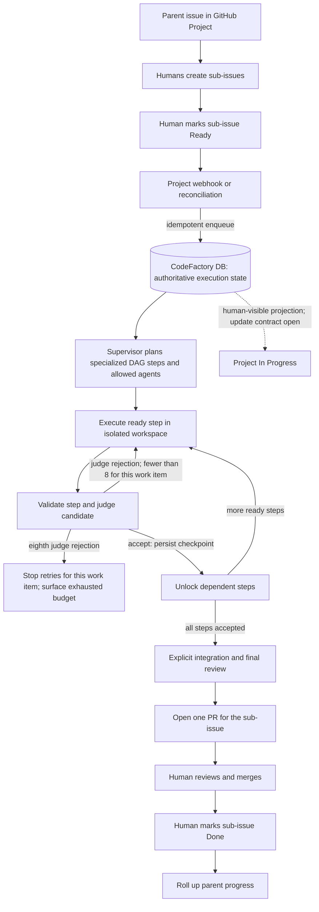

# Durable GitHub Issue Workflow

**Status:** Canonical intended issue-execution workflow; implementation incomplete.

This document is the source of truth for the intended CodeFactory GitHub-issue
execution workflow. It records adopted target behavior separately from verified
implementation and known gaps. It does not claim that target behavior is already
implemented.

## Ownership Boundaries

- **CodeFactory** owns application behavior: issue intake, supervisor planning,
  workers, execution state, validation/judgment, integration, and PR workflow.
  See the [CodeFactory README](../../README.md).
- **infra-codefactory** owns environment configuration, package selection, and
  rollout/deployment operations. See [organization rollouts](../../../infra-codefactory/docs/organization-rollouts.md).
- **inference-platform** owns the model-serving chart/runtime. See the
  [inference GPU and runtime contract](../../../inference-platform/docs/inference-gpu-contract.md).
- **local-llm-benchmark** is a pilot workload, not a CodeFactory runtime
  dependency absent concrete coupling through a required runtime interface.

## Verified Current State And Gaps

- CodeFactory has a durable SQLite-backed task path and an issue-only bounded
  pipeline for an assigned worker, authenticated GitHub snapshot, structured
  coder edits, scoped validation, judge review, branch/PR publication, and
  durable terminal result. See [new-repository setup](../operations/new-repo-setup.md).
- The resident claimed-task path now invokes a staged LangGraph workflow with an
  async SQLite checkpointer. It preserves the verified candidate, judge, scoped
  worker, and human-gated PR operations, while the separate legacy mock-only
  `TaskState` graph remains outside the durable path. Focused local tests cover
  manual API intake, checkpoint recovery, DB precedence, task/thread identity,
  PR replay, and the no-merge gate. A live issue-to-PR runtime run has not been
  performed. See the [Phase 1 implementation evidence](durable-issue-workflow-plan.md).
- GitHub Project changes are not currently consumed by CodeFactory. Current
  Project statuses are `Todo`, `In Progress`, and `Done`; `Ready` is not
  configured. Project-driven enqueue, human-created sub-issue coordination,
  multi-step DAG execution, per-step checkpoints/retries, one-PR-per-sub-issue
  integration, and parent progress rollup are target behavior, not current
  implementation.
- Tests and setup documentation describe local/mock verification, not a proven
  live GitHub issue-to-PR execution. See [new-repository setup](../operations/new-repo-setup.md).

The [thinktank plan](thinktank-plan.md) documents approved architecture intent,
not evidence that the durable LangGraph workflow has been built. The
[keep-vs-defer note](keep-vs-defer-architecture.md) provides the bounded
supervisor/worker/judge and human PR-gate context.

## Adopted Target Workflow

### Planning And Intake

GitHub Project is the human planning, visibility, and control surface. The
CodeFactory database remains authoritative for execution state after successful
intake. A parent issue groups related work; humans create its sub-issues as work
packages. Each sub-issue may receive a multi-agent plan. Labels provide context
only and must never select or authorize agents.

Configure a `Ready` Project status for the human handoff. The intended intake
sequence is: a human marks a sub-issue `Ready`, then a Project integration
webhook or reconciliation process idempotently enqueues that sub-issue in
CodeFactory. Project state is an intake signal, not runtime authority after
successful enqueue. CodeFactory's database tracks execution from that point.

`In Progress` is a human-visible status/projection of active execution, not a
second execution-state authority. The responsible component, update mechanism,
and behavior when the projection is stale remain open design details. A human
marks the sub-issue `Done` after merging its PR; CodeFactory does not infer that
human decision from PR creation. Parent progress rolls up from its sub-issues,
with the exact rollup contract still to be defined.

### Execution And Completion

For each enqueued sub-issue, the supervisor plans specialized DAG steps and
assigns only allowed agents. Execute ready steps in isolated workspaces. Validate
each step's result and have the judge assess its candidate against that step's
acceptance criteria. For retry accounting, one object is one planned DAG-step
work item within one sub-issue. Count judge rejections for that object only, not
total issue-loop iterations. The fixed limit is 8 judge rejections per object;
after the eighth rejection, stop automatic retries for that object and surface
the exhausted budget. This is not an 8-iteration cap across the entire issue,
and exhaustion does not imply automatic replanning. Acceptance records a durable
checkpoint and unlocks dependent DAG steps. Labels are context for planning and
must not bypass the allowed-agent policy.

When every DAG step is accepted, run an explicit integration step and final
review across the combined work. Open **one PR per sub-issue**, never one PR per
agent step. A human reviews and merges that PR, then marks the sub-issue `Done`
in the Project. Parent progress is updated from sub-issue completion.

### Status Semantics

| Surface/status | Current state | Intended meaning |
| --- | --- | --- |
| `Todo` | Configured in the Project. | Human-planned work not yet handed to CodeFactory. |
| `Ready` | Not configured; Project changes are not consumed by CodeFactory. | Human handoff signal that makes a sub-issue eligible for idempotent enqueue. |
| `In Progress` | Configured; no Project-to-CodeFactory status integration. | Human-visible projection of active execution. Who updates it, when, and how stale projections are repaired remain open. |
| `Done` | Configured; no Project-to-CodeFactory status integration. | Human decision after PR merge. It is not set by enqueue, step completion, or PR creation. |
| CodeFactory DB state | Authoritative for the existing task lifecycle. | Authoritative execution record after intake, including task identity, lifecycle, results, and operational events. |
| LangGraph checkpoint | No checkpointer on the current graph. | Resumability data coordinated with the DB; never a competing authority for task status or business results. |

## LangGraph Durability Contract

Use LangGraph for the durable issue execution workflow. The CodeFactory database
continues to own execution identity, lifecycle/status, business results, and
operational events. Graph checkpoints store execution/resumption data and must be
coordinated with DB writes; they do not replace the DB as authority.

The implementation must explicitly design and test:

- Consistency between database transactions and checkpoint writes, including
  partial failures and which state is authoritative during recovery.
- Idempotency for Project intake/reconciliation, task and graph creation, step
  dispatch/completion, checkpoint effects, integration, and PR publication.
- Crash, replay, and recovery behavior around DB writes, checkpoint writes,
  worker operations, and GitHub API side effects.
- Task identity versus graph/thread identity, including uniqueness, stable
  mapping, retention, and checkpoint/schema migration.
- Retry ownership so a rejected candidate retries only its DAG-step work item,
  without duplicating accepted work or unlocking dependents prematurely; count
  up to 8 judge rejections per object and surface exhaustion without automatic
  replanning.

### Phase 1 Decisions And Evidence

- The supervisor uses `langgraph-checkpoint-sqlite>=3.1,<4.0` with
  `AsyncSqliteSaver`. Checkpoints live beside the task DB on the shared persistent
  volume as `/data/tasks/checkpoints-v<schema>-attempt-<n>.sqlite3`; the optional
  `TASK_CHECKPOINT_DB_DIR` selects another durable directory. Checkpoint files are
  separate from `tasks.sqlite3`.
- There is no automatic checkpoint pruning. Files remain for the lifetime of
  their task records unless an operator explicitly applies a retention policy.
  Schema version and attempt are part of the filename, so a new version/attempt
  starts with a fresh cursor without overwriting prior checkpoint history.
- The DB `task_id` is the graph `thread_id`. Checkpoint state contains only task
  ID, attempt, schema version, and graph routing flags; plans, candidate/result,
  judge outcomes, PR identity, status, and event history remain DB-authoritative.
- Every graph stage rereads the task row and requires the current running claim
  owner and attempt before proceeding. DB writes precede checkpoint progression.
  On lease recovery in the same attempt, the same thread and checkpoint file are
  resumed; after a new attempt, the DB row selects a new attempt-scoped file.
- Worker dispatch reuses its deterministic task/attempt Job and DB job/result.
  Judge acceptance is recorded before publication. Publication records intent,
  commits the PR URL with its completion event, reuses an existing task branch
  and open PR, and rereads after GitHub rejects a concurrent duplicate create.
  Terminal gateway writes are claim/attempt fenced and require the DB-recorded PR
  URL. CodeFactory never merges.
- Tests exercise manual POST intake through the graph, lease recovery after an
  interrupted completion, checkpoint-write failure after DB writes, selected
  SQLite path/retention behavior, PR replay/race handling, and no merge requests.
  A live manual issue run is not claimed: no designated issue/repository and
  live GitHub App/cluster run authorization were supplied.

## Implementation Sequence

1. **Prove the manual path.** Manually enqueue one issue and demonstrate
   end-to-end LangGraph execution, durable recovery after interruption, a
   validated result, and exactly one PR while human merge remains required.
   Keep Project webhook/reconciliation out of this stage.
2. **Complete execution semantics.** Implement the step DAG, isolated
   workspaces, allowed-agent policy, step validation/judgment, step-local bounded
  retries (up to 8 judge rejections per planned DAG-step work item, with
  exhaustion surfaced and automatic retries stopped), durable checkpoints,
  explicit integration/final review, and one PR per sub-issue. Preserve the
  human merge and `Done` gates.
3. **Add Project intake only after the manual workflow is stable.** Configure
   `Ready`, then add webhook intake and reconciliation with idempotent enqueue,
   authentication, event deduplication, and safe replay.
4. **Add visibility contracts.** Define and implement `In Progress` projection
   ownership/update behavior and parent progress rollup, including stale-state
   repair and human `Done` semantics.

## Open Design Details

- Define the future DAG step/workspace contracts, acceptance policy, allowed
  agents, and final integration/review boundaries.
- Define idempotency keys and side-effect guards for intake, DAG steps,
  integration, branches, and PR publication.
- Define allowed-agent policy, acceptance criteria, and the boundary between
  step validation and final review. The per-object limit is fixed at 8 judge
  rejections.
- Define who/how updates the `In Progress` projection and how stale Project
  status is reconciled without overriding DB execution state.
- Define parent/sub-issue identity and the parent progress rollup contract.
- Before Project intake, define webhook authentication, event deduplication,
  reconciliation cadence/authority, and GitHub-versus-DB disagreement handling.

This document specifies intended behavior only. Updating it makes no code,
GitHub issue/Project, deployment, or rollout changes.